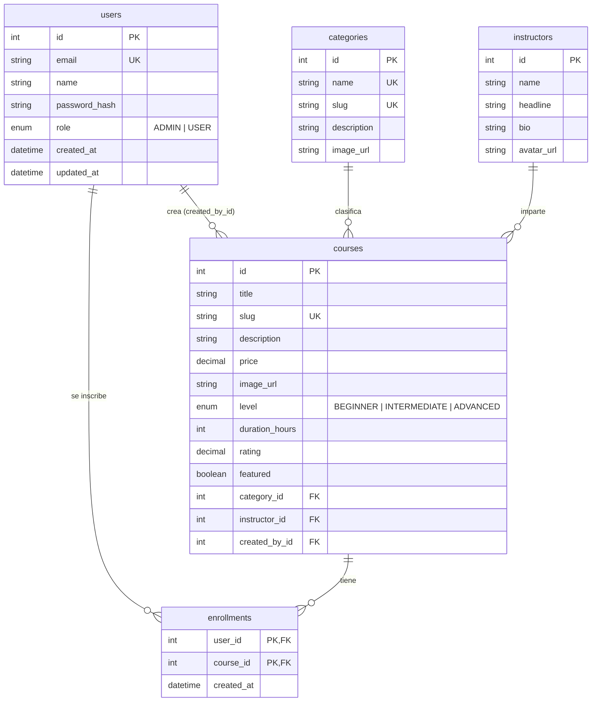

# Diagrama entidad-relación

## Normalización (3NF)

- **1FN:** todos los atributos son atómicos; no hay listas ni grupos repetidos en una columna.
- **2FN:** todas las tablas con PK simple (`id`) no tienen dependencias parciales. En `enrollments`, la PK compuesta `(user_id, course_id)` solo contiene `created_at`, que depende de la pareja completa.
- **3FN:** no hay dependencias transitivas. El nombre de la categoría vive solo en `categories` y los datos del instructor solo en `instructors`; `courses` guarda únicamente sus llaves foráneas.

## Reglas de integridad

| Relación | Regla | Efecto |
|---|---|---|
| `courses.category_id` → `categories` | `ON DELETE RESTRICT` | No se puede borrar una categoría con cursos (API responde 409) |
| `courses.instructor_id` → `instructors` | `ON DELETE RESTRICT` | No se puede borrar un instructor con cursos (409) |
| `courses.created_by_id` → `users` | `ON DELETE SET NULL` | Si se borra el admin, el curso se conserva |
| `enrollments.*` | `ON DELETE CASCADE` | Al borrar usuario o curso, desaparecen sus inscripciones |
